# ECDAT — Enterprise Cryptographic Discovery & Analysis Tool
### National Technical Research Organisation (NTRO) / Smart India Hackathon (SIH26164)
#### Production-Ready Evidence-Based Cryptographic Inventory, Post-Quantum Risk Analysis, Autonomous Remediation Loop & Closed-Loop Verification

[-emerald.svg)](backend/tests)
[](frontend)
[](backend/engine/cbom_generator.py)
[](backend/engine/standards_mapping.py)
[](backend/engine/standards_mapping.py)
[](backend)

---

## 1. Executive Summary & Problem Overview

Modern enterprise environments depend on heterogeneous, opaque cryptographic primitives embedded across polyglot source code repositories, compiled native binaries, embedded firmware images, active TLS networks, container runtimes, and legacy packet dumps.

With the ratification of NIST Post-Quantum Cryptography standards (FIPS 203 ML-KEM, FIPS 204 ML-DSA, FIPS 205 SLH-DSA), global national security mandates (NSA CNSA 2.0, White House OMB M-23-02, BSI TR-02102), and the imminent threat of **Harvest-Now, Decrypt-Later (HNDL)** attacks by nation-state adversaries, organizations face an existential cryptographic governance challenge.

**ECDAT (Enterprise Cryptographic Discovery and Analysis Tool)** is a state-of-the-art cybersecurity command platform designed to address this challenge. It replaces superficial regex grep scripts with:
- **Multi-Surface Discovery**: AST-based static source analysis, deep ELF/PE binary section disassembly, active TLS & hybrid PQC network probing, and passive PCAP protocol inspection.
- **Strict Evidence Model**: Every discovery produces a tamper-evident, deterministic `EvidenceRecord` tracking location, confidence, calling scope, and provenance hash.
- **Crypto Asset Knowledge Graph**: Multi-surface evidence fusion with automated identity correlation and reverse BFS blast-radius modeling.
- **Interactive Quantum Resource Estimation**: Algorithmic Shor's algorithm simulator calculating physical vs. logical qubits, surface code cycles, Toffoli gates, and time-to-break under realistic noise models.
- **Autonomous Remediation Loop ("Custom Loop")**: Single-click end-to-end pipeline: **Scan $\rightarrow$ CBOM & Quantum Risk Report $\rightarrow$ AST-Safe Cryptographic Auto-Patching & Regression Test $\rightarrow$ Closed-Loop Verification**.
- **Dedicated Before & After Changes Hub**: Side-by-side synchronized code & configuration diff, vulnerability retirement accounting, security posture score improvement, and `.patch` export.
- **Closed-Loop Verification Engine**: Formal differential re-scan proof confirming elimination of weak primitives with zero introduced regressions.

---

## 2. System Architecture

```mermaid
flowchart TD
    subgraph S1 ["1. Multi-Modal Discovery Layer"]
        SRC["Source Code Scanner\n(Polyglot AST: Python, C/C++, Java, Go, Rust, JS/TS)"]
        BIN["Deep Binary & Firmware Inspector\n(ELF, PE, Mach-O, Opcode Statistics, Shannon Entropy)"]
        NET["Active Network & TLS Prober\n(TLS 1.0-1.3, X.509 Certificate Chain, Hybrid PQC Groups)"]
        PCAP["Passive Network Inspector\n(TLS Handshake Dissection, JA3/JA4 Fingerprints, X25519MLKEM768)"]
        TRACE["Runtime & eBPF Telemetry\n(OpenSSL libcrypto.so Probes, Syscall Tracking, PID Tracing)"]
    end

    subgraph S2 ["2. Normalization & Evidence Fusion"]
        NORM["Unified EvidenceRecord Normalizer\n(AssetType, CryptographicRole, Confidence, Location, Source Hash)"]
        CORR["Cross-Surface 5-Tier Correlator\n(Host -> Binary -> Process -> Source -> Library)"]
        GRAPH["Crypto Asset Knowledge Graph\n(Reverse BFS Upstream/Downstream Blast Radius)"]
    end

    subgraph S3 ["3. Risk Analysis & Mandate Mapping"]
        MOSCA["Mosca's Theorem Engine\n(Shelf Life X + Migration Y > CRQC Horizon Z)"]
        QRE["Quantum Resource Estimator\n(Shor's Algorithm on Fault-Tolerant Surface Codes)"]
        MANDATE["Standards & Regulatory Matrix\n(NIST FIPS 203/204/205, CNSA 2.0, BSI TR-02102, PCI-DSS 4.0)"]
        ML["Binary ML Classifier\n(Entropy Profile, Byte Histograms, Opcode N-Grams, Crypto Constants)"]
    end

    subgraph S4 ["4. Autonomous Remediation Pipeline ('Custom Loop')"]
        LOOP["Autonomous Custom Loop Controller\n(One-Click Pipeline Orchestrator)"]
        PATCH["Deterministic Auto-Patch Engine\n(AST Transformations: MD5->SHA-256, DES->AES-256, RSA-1024->ML-KEM)"]
        REGRESS["Differential Regression Test Harness\n(Automated Isolated Execution & Assertion Verification)"]
    end

    subgraph S5 ["5. Verification & Audit Reporting"]
        VER["ClosedLoopVerifier Engine\n(Baseline Evidence vs. Post-Migration Evidence)"]
        DIFF["Dedicated Before & After Changes Hub\n(Side-by-Side Diff, Metric Delays, Verified Badge, .patch Export)"]
        CBOM["CycloneDX 1.6 CBOM Exporter\n(Schema-Compliant Cryptography Bill of Materials)"]
    end

    S1 --> S2
    S2 --> S3
    S3 --> S4
    S4 --> S5
```



---

## 3. Core Feature Catalog

### 🔄 1. Autonomous Custom Loop ("One-Click Remediation Pipeline")
- **One-Click Execution**: Accepts source code (Python, C/C++, Java, Go) or binary executable files (ELF, PE, raw binary).
- **Automated 4-Stage Execution**:
  1. **Stage 1 (Scan & Discover)**: Scans input target, extracts all classical and quantum-vulnerable primitives, algorithms, and key sizes.
  2. **Stage 2 (Report & Quantum Risk)**: Synthesizes CycloneDX 1.6 CBOM and calculates Mosca's Theorem deficit timeline.
  3. **Stage 3 (Auto Patch & Test)**: Applies safe, deterministic AST migration templates and runs isolated differential regression tests.
  4. **Stage 4 (Closed-Loop Verify)**: Executes differential re-scan and proves complete weakness retirement with zero regressions.
- **Direct Handoff**: Renders live stage stepper, instant `VERIFIED` card, and a one-click CTA to the dedicated Changes page.

### 🔀 2. Dedicated Before & After Changes Page (`/changes` & `/projects/[projectId]/changes`)
- **Side-by-Side Synchronized Diff Viewer**:
  - Left pane: Baseline code with red line highlights marking deprecated primitives (MD5, DES, RSA-1024).
  - Right pane: Remediated code with green line highlights marking post-quantum primitives (SHA-256, AES-256-GCM, FIPS 203 ML-KEM-768).
  - Synchronized line numbers and syntax highlighting.
- **Security Posture Comparison Matrix**:
  - Critical Vulnerabilities: $2 \rightarrow 0$ (Weaknesses retired).
  - Security Posture Score: $28 \rightarrow 98$ (+70 points increase).
  - Quantum Deficit (Mosca): $4\text{ years} \rightarrow 0\text{ years}$ (CRQC Secure).
  - Crypto-Agility Index: $2.1 \rightarrow 9.4$.
- **Tabbed Audit Suite**:
  - **Differential Regression Test**: Displays generated test code and live stdout execution logs (`PASSED`).
  - **Verification Evidence Diff**: Lineage table listing retired weaknesses and introduced protections.
  - **CycloneDX 1.6 CBOM Metadata**: Cryptographic bill of materials specification details.
- **Export Capabilities**: One-click **Download .patch** and **Copy Diff**.

### 🛡️ 3. Closed-Loop Verification Engine
- Evaluates migration outcomes by comparing baseline evidence records against post-migration evidence records.
- Eliminates false positives by verifying:
  - **Weakness Retirement**: Deprecated algorithms (e.g., RSA-1024, MD5, DES, TLS 1.0) are absent in the re-scan.
  - **Protection Introduction**: Post-quantum algorithms (ML-KEM, ML-DSA) or modern ciphers (AES-256-GCM, SHA-256) are confirmed present.
  - **Zero Regressions**: No newly introduced weak primitives exist in the post-migration state.
- Emits authoritative verdicts: `VERIFIED`, `NOT_VERIFIED`, or `INCONCLUSIVE`.

### 📜 4. Standards & Regulatory Compliance Matrix
- Maps all findings to leading cryptographic governance frameworks:
  - **NIST FIPS 203**: Module-Lattice-Based Key-Encapsulation Mechanism (ML-KEM).
  - **NIST FIPS 204**: Module-Lattice-Based Digital Signature Algorithm (ML-DSA).
  - **NIST FIPS 205**: Stateless Hash-Based Digital Signature Algorithm (SLH-DSA).
  - **NSA CNSA 2.0**: Commercial National Security Algorithm Suite mandates.
  - **BSI TR-02102**: German Federal Office for Information Security cryptographic requirements.
  - **PCI-DSS v4.0**: Payment Card Industry strong cryptography requirements.
  - **NIST SP 800-52r2**: Guidelines for TLS implementations.

### ⚛️ 5. Interactive Quantum Resource Estimator
- Realistic quantum cryptanalysis modeling based on Shor's algorithm on surface code fault-tolerant quantum architectures:
  - Target algorithms: RSA-2048, RSA-3072, RSA-4096, ECC P-256, ECC P-384, Curve25519.
  - Adjustable parameters: Physical Gate Error Rate ($10^{-3} - 10^{-4}$), Surface Code Cycle Time (0.1 - 10 $\mu\text{s}$).
  - Computed outputs: Logical Qubit requirements, Physical Qubit requirements (including magic state distillation factories), Surface Code Distance ($d$), Toffoli gate depth, and estimated wall-clock decryption time.
  - Peer-reviewed literature references (Gidney & Ekerå 2021, Roetteler et al. 2017).

### ⚡ 6. Cryptographic Auto-Patch Engine
- Standalone interactive patch studio for rapid code remediation.
- Deterministic AST transformation templates for Python, C/OpenSSL, and binary compilation Makefiles.
- Automated differential regression testing executed via subprocess to confirm that the upgraded code functions correctly before applying.

### 🔬 7. Dynamic Runtime & eBPF Telemetry
- **Runtime Tracing**: Dynamic instrumentation of running processes to capture live cryptographic function invocations (e.g., OpenSSL `MD5()`, `RSA_generate_key_ex()`, Python `hashlib`).
- **eBPF Kernel Probes**: Kernel-level capability inspector and uprobe hooks to intercept `libcrypto.so` calls in production containers without application modification.

### 📦 8. Binary ML Classifier & Passive PCAP Protocol Inspector
- **Binary ML Classifier**: Deep binary analysis extracting Shannon entropy profiles, byte chi-square randomness statistics, opcode distributions (bitshift, XOR, arithmetic ratios), and embedded cryptographic constant signatures to detect stripped, hidden, or statically compiled crypto libraries.
- **Passive PCAP Protocol Inspector**: Parses raw and synthetic PCAP packet captures, dissects TLS 1.2 and TLS 1.3 ClientHello and ServerHello records, extracts JA3/JA4 client fingerprints, and identifies post-quantum hybrid key exchange groups (e.g., `X25519MLKEM768`).

### 🌐 9. Executive Command Center & Enterprise UI Shell
- Modern, high-density dark-mode cyber defense interface designed for Chief Information Security Officers (CISOs) and security engineers.
- Interactive KPI cards, Risk Distribution donut chart, Algorithm Family frequency bar charts, Multi-Surface discovery coverage matrix, and Evidence-Driven Action Queue.
- Global Command Palette (`⌘K`) for rapid navigation across projects, assets, and scans.
- Google AI Studio / Gemini API Cryptographic Copilot for automated vulnerability triage, quantum risk explanation, and migration advisory.

---

## 4. Repository Structure

```text
SIH64/
├── backend/
│   ├── engine/
│   │   ├── custom_loop.py           # Autonomous 1-click Custom Loop pipeline
│   │   ├── verifier.py              # Closed-Loop Differential Verification engine
│   │   ├── patch_engine.py          # Deterministic AST migration patch engine
│   │   ├── quantum_estimator.py     # Shor's algorithm surface code quantum estimator
│   │   ├── quantum_risk.py          # Mosca's Theorem (X + Y > Z) risk calculator
│   │   ├── standards_mapping.py     # NIST, CNSA 2.0, BSI, PCI-DSS compliance catalog
│   │   ├── runtime_tracer.py        # Dynamic execution tracing engine
│   │   ├── ebpf_tracer.py           # eBPF kernel uprobe & capability inspector
│   │   ├── binary_classifier.py     # Statistical & ML binary crypto classifier
│   │   ├── pcap_engine.py           # Pure-Python PCAP parser & TLS/PQC dissector
│   │   ├── source_scan.py           # AST & regex polyglot source code scanner
│   │   ├── binary_deep.py           # ELF, PE, Mach-O deep binary scanner
│   │   ├── website_inspector.py     # Active TLS network & certificate prober
│   │   ├── cbom_generator.py        # CycloneDX 1.6 CBOM generation engine
│   │   ├── knowledge_graph.py       # Cryptographic asset relational graph
│   │   ├── correlator.py            # 5-tier cross-surface evidence correlator
│   │   ├── blast_radius.py          # Reverse BFS blast radius impact calculator
│   │   ├── temporal/                # Temporal crypto posture & drift intelligence
│   │   ├── posture/                 # Continuous security posture pipeline
│   │   ├── archive_lab/             # .ecvault secure archive protected containers
│   │   └── gemini_assistant.py      # Google AI Studio / Gemini security copilot
│   ├── tests/                       # 690 comprehensive pytest unit & integration tests
│   ├── main.py                      # FastAPI REST application entrypoint & routing
│   ├── requirements.txt             # Python backend dependencies
│   └── Dockerfile                   # Production Docker container definition
├── frontend/
│   ├── src/
│   │   ├── app/
│   │   │   ├── page.tsx             # Root landing page (routes to workspace)
│   │   │   ├── dashboard/page.tsx   # Dashboard route (redirects to Left UI workspace)
│   │   │   ├── changes/page.tsx     # Changes route (redirects to /projects/default/changes)
│   │   │   ├── projects/
│   │   │   │   ├── page.tsx         # Projects catalog
│   │   │   │   └── [projectId]/
│   │   │   │       ├── page.tsx     # Enterprise Cyber Command Center (Left UI)
│   │   │   │       └── changes/
│   │   │   │           └── page.tsx # Dedicated Before & After Changes Hub
│   │   │   ├── layout.tsx           # Application root layout with dark mode
│   │   │   └── globals.css          # Tailwind CSS v4 design tokens and theme
│   │   ├── components/
│   │   │   └── ecdat/
│   │   │       ├── custom-loop-panel.tsx   # Autonomous loop interactive controller
│   │   │       ├── verification-panel.tsx # Closed-loop verification diff panel
│   │   │       ├── standards-panel.tsx    # Standards compliance matrix panel
│   │   │       ├── experimental-hub.tsx   # Quantum, AutoPatch, Runtime, Binary ML, PCAP
│   │   │       └── theme-toggle.tsx       # Dark/light mode switcher
│   │   └── lib/
│   │       └── api.ts               # Type-safe API client & data interfaces
│   ├── package.json                 # Next.js 16 + React 19 dependencies
│   └── next.config.ts               # Next.js configuration & API reverse proxy
├── run.sh                           # One-click startup script (installs and starts both servers)
└── README.md                        # Master project documentation
```

---

## 5. API Reference

The backend exposes a comprehensive RESTful API under `/api`. Below are key endpoints:

| Method | Endpoint | Description |
|---|---|---|
| `POST` | `/api/custom-loop/run` | Executes the 1-click autonomous scan, report, patch, and verify pipeline |
| `GET` | `/api/custom-loop/latest` | Retrieves the latest custom loop execution result |
| `POST` | `/api/verify` | Executes closed-loop differential verification between baseline and post-migration scans |
| `GET` | `/api/standards/mapping` | Returns regulatory compliance mappings (NIST, CNSA 2.0, BSI, PCI-DSS) |
| `POST` | `/api/risk/quantum-estimation` | Calculates Shor's algorithm quantum resource requirements (qubits, surface code, runtime) |
| `POST` | `/api/experimental/autopatch` | Generates AST cryptographic migration patch and executes differential regression test |
| `POST` | `/api/experimental/runtime-trace` | Traces cryptographic function calls during dynamic execution |
| `GET` | `/api/experimental/ebpf-capabilities`| Inspects kernel eBPF probe availability and tracing capabilities |
| `POST` | `/api/experimental/binary-ml` | Classifies compiled binary buffer using entropy, opcodes, and ML models |
| `POST` | `/api/scan/pcap` | Parses uploaded PCAP bytes and extracts TLS handshakes / PQC hybrid groups |
| `POST` | `/api/scan/pcap/synthetic` | Generates and analyzes synthetic TLS 1.3 + ML-KEM hybrid packet capture |
| `POST` | `/api/scan/sources` | Scans source code files for cryptographic primitives |
| `POST` | `/api/scan/binary/upload` | Performs deep inspection on uploaded ELF, PE, or firmware binary |
| `POST` | `/api/scan/network` | Actively probes target website or host for TLS cipher suites and certificates |
| `POST` | `/api/export/cbom` | Generates schema-compliant CycloneDX 1.6 Cryptography Bill of Materials |
| `POST` | `/api/ai/triage` | Uses Google AI Studio / Gemini API to triage custom or obscure cryptographic code |

---

## 6. Quickstart & Installation Guide

### Prerequisites
- **Python**: 3.11 or higher
- **Node.js**: 18 or higher (Node 20+ recommended)
- **OpenSSL**: 3.0 or higher (OpenSSL 3.2+ with hybrid ML-KEM support recommended)

### Quick Launch with `./run.sh`
The repository includes an automated bootstrap script that initializes the virtual environment, installs dependencies, builds the frontend, and launches both services:

```bash
chmod +x run.sh
./run.sh
```

Once started:
- **Frontend Command Center**: [http://localhost:3000](http://localhost:3000)
- **Backend Swagger API Docs**: [http://localhost:8000/docs](http://localhost:8000/docs)
- **Direct Workspace**: [http://localhost:3000/projects/default](http://localhost:3000/projects/default)
- **Before & After Changes Hub**: [http://localhost:3000/projects/default/changes](http://localhost:3000/projects/default/changes)

---

### Manual Step-by-Step Setup

#### 1. Backend Setup
```bash
# Navigate to repository root
cd /path/to/SIH64

# Create and activate Python virtual environment
python3 -m venv .venv
source .venv/bin/activate

# Install backend dependencies
pip install -r backend/requirements.txt

# Start backend FastAPI server on port 8000
cd backend
PYTHONPATH=. python main.py
```

#### 2. Frontend Setup
```bash
# In a new terminal window:
cd /path/to/SIH64/frontend

# Install npm dependencies
npm install

# Start development server on port 3000
npm run dev
```

---

## 7. Automated Testing & Verification

The ECDAT test suite provides exhaustive coverage across all engines, scanners, risk models, and verification pipelines.

To execute the complete 690-test suite:
```bash
cd backend
PYTHONPATH=. ../.venv/bin/python -m pytest tests/ -v
```

### Test Suite Breakdown:
- `test_custom_loop.py`: Validates autonomous loop execution across Python, C, and Binary targets.
- `test_p3_migration_*.py`: Verifies closed-loop differential verification, weakness retirement, and regression detection.
- `test_pqc_discovery.py`: Validates TLS 1.3 ML-KEM hybrid handshake dissection.
- `test_p1_binary_deep.py`: Validates ELF/PE section parsing, entropy profiling, and constant extraction.
- `test_cbom_generator.py`: Validates CycloneDX 1.6 schema compliance.
- `test_quantum_risk.py`: Validates Mosca's theorem and CRQC deficit equations.
- `test_standards_mapping.py`: Validates regulatory cross-mappings (CNSA 2.0, FIPS 203, BSI).
- `test_gemini_assistant.py`: Validates Google AI Studio / Gemini API cryptographic copilot integration.

To verify frontend TypeScript compilation and production build:
```bash
cd frontend
npm run build
```

---

## 8. License & Attribution

Developed for the **National Technical Research Organisation (NTRO)** under the **Smart India Hackathon (SIH26164)**.
All rights reserved. Designed for high-assurance cryptographic governance, post-quantum readiness, and closed-loop security engineering.
